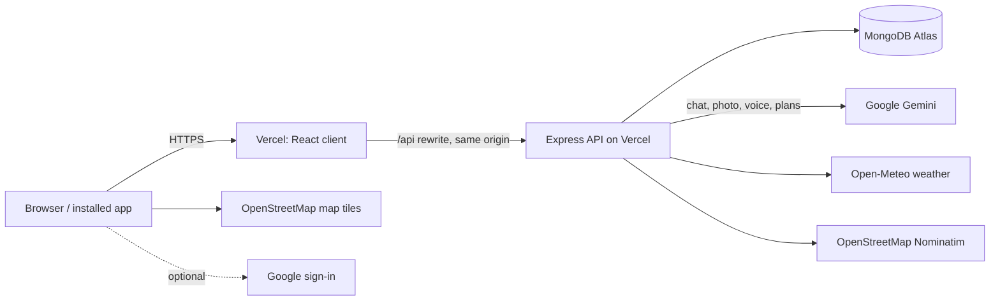
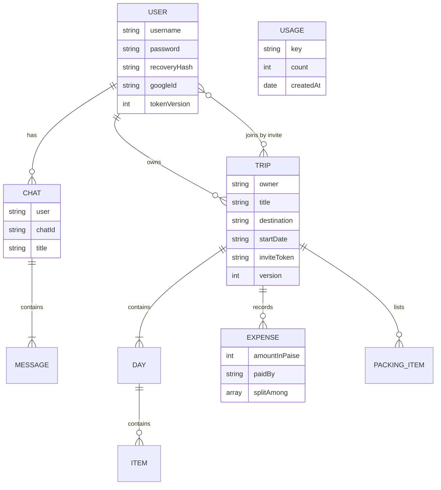
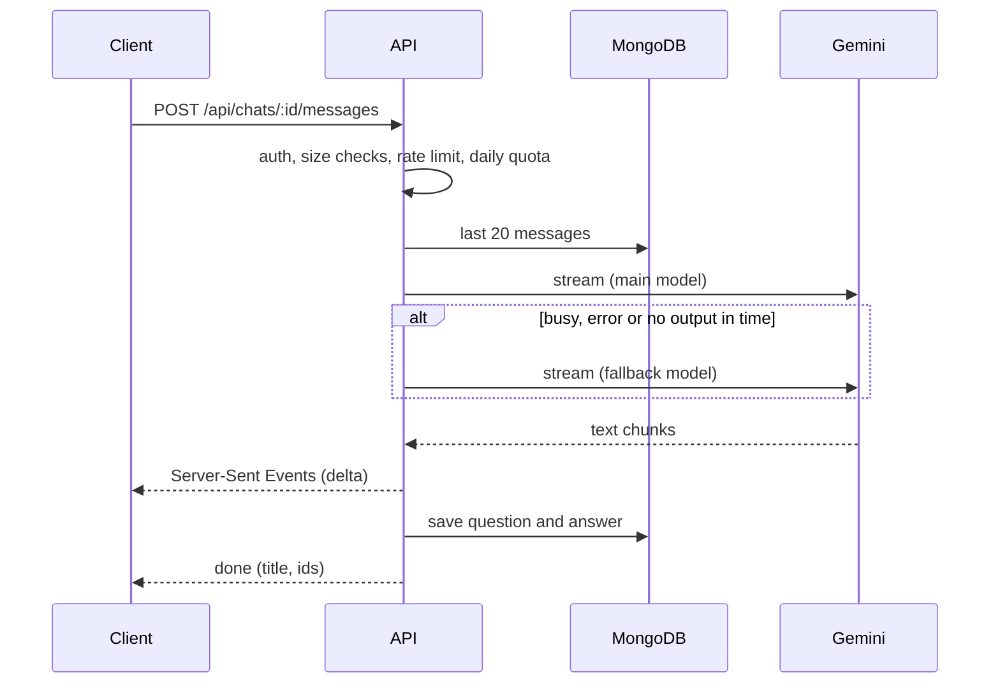

# LocoMan architecture

## System



The browser only talks to its own origin for data, so the session cookie is first party and
no CORS is needed. API keys exist only on the server.

## Client (React, Vite, Tailwind)

| Part | Files | Job |
|---|---|---|
| Shell and routing | `App.jsx`, `lib/router.js`, `Sidebar` | Session, pages, offline mode |
| Chat | `ChatScreen`, `Composer`, `Message`, `LiveVoice` | Streaming replies, photo, voice |
| Trips | `Trips`, `TripPage`, `Itinerary`, `TripMap`, `Budget`, `Packing`, `TripInfo`, `TripShare` | One component per tab |
| Discover | `Discover` | AI destination ideas |
| Account | `AuthPage`, `Account`, `Privacy`, `GoogleButton` | Sign in, recovery, deletion |
| Pure logic (tested) | `lib/split`, `lib/ics`, `lib/route`, `lib/speech`, `lib/sse`, `lib/booking` | No React, no network |
| Offline | `public/sw.js`, `lib/offline.js` | App shell cache and saved trips |

## Server (Node, Express)

```text
index.js            entry: wires config, AI, places, Google verifier
src/app.js          middleware and routes (dependencies injected, so tests use fakes)
src/config.js       environment validation
src/db.js           connection that retries per request (serverless safe)
src/middleware/     auth, rate limits and daily quota, errors
src/routes/         auth, chats, trips, places
src/services/       ai (Gemini), places (weather, geocoding), google (token check)
src/lib/trip.js     cleaning of itinerary, packing and ideas (users and AI are both untrusted)
models/             User, Chat, Trip, Usage
```

## Data model



Days, items, expenses and packing are embedded in the trip document. `Usage` rows expire after two days.

## Chat reply



## Key decisions

| Decision | Why | Trade-off |
|---|---|---|
| Same-origin `/api` rewrite | Cookies work in every browser | Server URL is written in the client's `vercel.json` |
| Server saves chats | Client cannot overwrite history | |
| Version number on trip edits | Group members cannot silently overwrite each other | The second editor must reload |
| Expenses added atomically | Two people can add at once | |
| Recovery code, no email | No mail provider needed | A lost code and password cannot be recovered |
| Google accounts matched by Google id only | Prevents account takeover by name | Same person can have two accounts |
| AI edits are previewed first | AI can be wrong | One extra tap |
| Quota stored in MongoDB | Survives restarts and serverless instances | |

## Security

HTTP-only SameSite cookie, bcrypt, `tokenVersion` to end sessions, ownership checks on every
query, input limits, per-minute limits and daily AI quota, strict Content-Security-Policy,
no HTML from the model or users is rendered, photos and audio are never stored.

Known limits: per-minute limits are kept in memory, so on serverless each instance counts
separately (the daily quota does not have this problem). There is no admin panel or audit log.

## Deploy

Push to `main` in each repo and Vercel deploys it. Deploy the server first when the API changes.
Environment: `MONGODB_URI`, `JWT_SECRET`, `GEMINI_API_KEY`; optional `GOOGLE_CLIENT_ID`,
`GEMINI_MODEL`, `GEMINI_FALLBACK_MODEL`, `USER_DAILY_LIMIT`, `GLOBAL_DAILY_LIMIT`.

## Group and sharing

Votes and comments are stored on the trip, keyed by place id, and written atomically. Open trips
ask for the trip's last-change stamp every 10 seconds (polling works on serverless; no WebSocket).
A public page uses its own token and returns only the plan.

## Roadmap

| Item | Needs |
|---|---|
| Email verification and reset | An email provider (for example Resend) and a sending domain |
| Bot protection on sign-up | A Cloudflare Turnstile key |
| Error monitoring | A Sentry project |
| Ratings and opening hours | Google Places API with billing |
| Current answers from Google Search | Paid Gemini, plus Google's display rules |
| Affiliate booking links | Approved affiliate accounts |
| Premium plan and payments | A payment provider (for example Razorpay) with KYC |
| Two-way live voice (Gemini Live) | Work only: short-lived tokens from the server, WebSocket from the browser |
| Full Hindi interface | Work only |
| Android and iOS apps (Capacitor) | Android Studio, Xcode, store accounts |
| Push notifications for weather | Work, plus a scheduled job |
